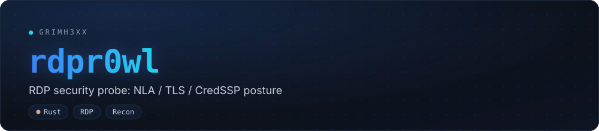

[](https://github.com/grimh3xx/rdpr0wl/actions)
[](LICENSE)


**RDP security probe in Rust** for authorised pentests. It runs the X.224/RDP
negotiation and reveals the host's **security posture**: plain RDP (insecure),
TLS, or mandatory **CredSSP/NLA** — handy to prioritise targets and flag boxes
exposed to downgrade/bruteforce.

<p align="center"></p>

> ## ⚠️ Authorised use only
> Run **only** against hosts you have explicit permission to test.

## Usage

```sh
rdpr0wl probe 10.0.0.10
rdpr0wl probe 10.0.0.10 --port 3389 --timeout 4000
```

Example output:

```
[+] 10.0.0.10:3389 — selected: TLS + CredSSP/NLA required (0x00000003)
```

It reads the `RDP_NEG_RSP`/`RDP_NEG_FAILURE` and decodes the bits (TLS, HYBRID,
HYBRID_EX) and failure codes (e.g. `HYBRID_REQUIRED_BY_SERVER`).

## Tests

```sh
cargo test --release
```

- Unit: the Connection Request is well-formed; neg-response/failure/legacy bytes
  decode correctly.
- Integration: a fake RDP server answers the negotiation and `probe` must read
  the selected protocol over a real socket.

## Credential validation (partial)

```sh
rdpr0wl check 10.0.0.10 -u admin -p Secret123
```

The **cryptographic core of NLA — NTLMv2 (NTOWFv2 + NTProofStr) — is implemented
and proven** against the official MS-NLMP reference vectors (`src/ntlm.rs`,
`cargo test`). The remaining piece is the CredSSP transport (TLS + TSRequest
ASN.1 + NTLMSSP + pubKeyAuth), which only means anything against a live
NLA-enabled host, so `check` reports an explicit status rather than faking a
result. This is the one capability in the suite that cannot be proven in a
Linux-only lab.

## Build

```sh
cargo build --release
```

## License

MIT. See [LICENSE](LICENSE).
