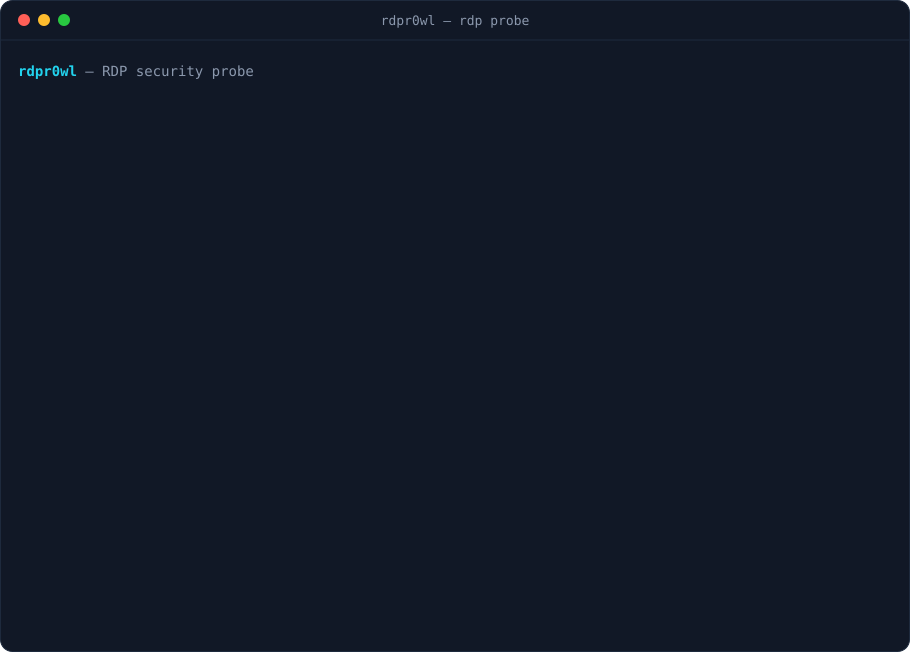

# rdpr0wl

[](https://github.com/grimh3xx/rdpr0wl/actions)
[](LICENSE)


**Sonda e (futuro) validador de RDP em Rust** para pentest autorizado. Faz a
negociação X.224/RDP e revela a **postura de segurança** do host: RDP puro
(inseguro), TLS, ou **CredSSP/NLA obrigatório** — útil pra priorizar alvos e
flagrar máquinas expostas a downgrade/bruteforce.

<p align="center"></p>

> ## ⚠️ Uso autorizado apenas
> Rode **somente** contra hosts com **permissão explícita**. A responsabilidade
> é sua.

## Uso

```sh
rdpr0wl probe 10.0.0.10
rdpr0wl probe 10.0.0.10 --port 3389 --timeout 4000
```

Saída de exemplo:

```
[+] 10.0.0.10:3389 — selecionou: TLS + CredSSP/NLA obrigatório (0x00000003)
```

Lê o `RDP_NEG_RSP`/`RDP_NEG_FAILURE` e traduz os bits (TLS, HYBRID, HYBRID_EX)
e os códigos de falha (ex.: `HYBRID_REQUIRED_BY_SERVER`).

## Validação de credencial (em desenvolvimento)

```sh
rdpr0wl check 10.0.0.10 -u admin -p Senha123
```

O caminho NLA/CredSSP completo (TLS + TSRequest ASN.1 + NTLMSSP) está no roadmap
em `src/nla.rs`, marcado explicitamente para não mascarar resultado.

## Build

```sh
cargo build --release
```

## Licença

MIT. Veja [LICENSE](LICENSE).
